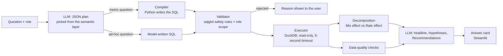

# pinelabs-ai-analyst

An AI Business Analyst for payments data (Pine Labs Case Study 02). A business
user asks a question in plain English, such as "Why did success rate drop in
week 6?", and gets an answer card: a headline, Facts backed by executed SQL, a
mix-vs-rate decomposition chart, Hypotheses, Recommendations and data-quality
Caveats.

Deployed app: https://pinelabs-ai-analyst-nlszjuhrufcg9lmk9b6tjv.streamlit.app/

Terms in capitals (Attempt, Success rate, Mix effect, ...) are defined in
[GLOSSARY.md](GLOSSARY.md). Design decisions D1-D37 are in
[docs/grilling.md](docs/grilling.md).

## Problem

Payment success rate is the number a payments business watches most, and the
one most easily misread. When it falls, the first question is "what broke?",
but often nothing broke: traffic moved to a payment method that always
succeeds less often. An analyst who answers by hand writes SQL, splits by
method, bank and category, and separates the two causes. That takes hours, and
each analyst defines the metric a little differently.

This app does that work in seconds, with one fixed definition of each metric.
It answers only from numbers it computed, shows the SQL behind every Fact, and
says plainly what it assumed and what the data cannot prove.

## Architecture



The model never writes the SQL for a metric question. It returns a small JSON
plan (metric, Weeks, filters), and Python compiles that plan into SQL from the
semantic layer. Only a question the semantic layer cannot express gets
model-written SQL, and that SQL passes through the same validator. Every number
on the card comes from executed SQL; the model only writes the prose around it.

| File | Job |
|------|-----|
| `semantic.py` | Tables, columns, joins, metrics and dimensions a plan may use |
| `analyst.py` | The pipeline: question and role in, answer card out |
| `compiler.py` | Plan to SQL, deterministically |
| `validator.py` | Safety rules and role scope, enforced on the SQL |
| `executor.py` | Read-only DuckDB, timeout, result cache |
| `decomposition.py` | Midpoint mix-vs-rate decomposition |
| `dq.py` | Data-quality checks per answer |
| `llm.py` | Free OpenRouter models, with a saved-reply cache |
| `generator.py` | Seeded synthetic data and the eval's expected answers |
| `evaluate.py` | Known-answer eval |
| `app.py`, `garden.py` | Streamlit UI and its pixel-art garden |

## How to run

Verified from a fresh clone on Python 3.15:

```
git clone https://github.com/aaryan-pradhan/pinelabs-ai-analyst
cd pinelabs-ai-analyst
python3 -m venv .venv && . .venv/bin/activate
pip install -r requirements.txt
pytest                 # tests build their own small database
streamlit run app.py   # builds payments.duckdb from the seed on first run
```

Live questions use a free OpenRouter model, so there are no paid calls. Put
your key in `.streamlit/secrets.toml` (gitignored) or the Streamlit Cloud
secrets:

```
OPENROUTER_API_KEY = "sk-or-..."
```

Without a key the app still starts. The demo questions replay (see below), and
any other question shows the SQL it would run. Identical prompts replay saved
replies from `.llm_cache/`, so reruns cost no quota.

Other commands:

```
python generator.py    # rebuild payments.duckdb and eval/expected.json
python evaluate.py     # run the eval on the live free model, write eval/result.json
```

## Data model

Synthetic and seeded (`seed=42`), in one DuckDB file. 8 Weeks, Monday 28 Sep to
Sunday 22 Nov 2026; Week 1 starts 28 Sep and Week 6 is Diwali week.

| Table | Columns | Rows |
|-------|---------|------|
| `transactions` | `txn_id`, `ts`, `merchant_id`, `bank_id`, `payment_method` (upi, card, netbanking, wallet), `amount`, `status` (success, failed), `failure_reason` | 152,402: 150,150 Attempts plus 2,252 Duplicates |
| `merchants` | `merchant_id`, `name`, `category` (6), `city` (10), `tier` (large, mid, small) | 300 |
| `banks` | `bank_id`, `name`, `type` (public, private, foreign) | 8, all fictional |
| `settlements` | `merchant_id`, `date`, `settled_amount`, `settled_count` | one per merchant per day with successful Attempts |

Joins: `transactions` to `merchants` on `merchant_id`, `transactions` to
`banks` on `bank_id`. Settlements are compared with Attempts only after both
are added up by merchant and transaction date.

The generator plants four stories for the demo and the eval to find:

1. **Week 6 mix shift.** A festive-sale merchant sends extra traffic to
   netbanking and wallet. The overall Success rate falls about 4 percentage
   points, but each payment method stays within 0.3 percentage points of Week 5.
2. **Week 7 real drop.** Coastal Bank's card Success rate falls from about 92%
   to 78%.
3. **Dirty rows.** About 1.5% of rows are exact Duplicates, and `bank_id`,
   `amount` and `failure_reason` have nulls.
4. **Week 5 Source mismatch.** Electronics merchants' Settlements are 3% below
   their successful Attempt value. Everywhere else they match.

## Metric definitions

All metrics read Attempts: `transactions` with Duplicates removed. The SQL is
in `semantic.py`.

| Metric | Definition |
|--------|------------|
| Attempts | Distinct `txn_id`s |
| Success rate | Successful Attempts / all Attempts. Failed Attempts with no reason still count. |
| GMV | Sum of `amount` over successful Attempts. Attempts with no amount are left out. |
| Average ticket | GMV / successful Attempts with a known amount |
| Failure share | A failure reason's failed Attempts / all failed Attempts in the same Week. No reason counts as "Unknown reason". |
| Settlements | Sum of `settled_amount` |
| Settlement gap | Settlements / successful Attempt value - 1, by merchant and date. Negative means settled short. |

Dimensions: Week, payment method, bank, bank type, category, city, tier,
merchant, failure reason. Attempts with no bank form their own "Unknown bank"
Segment.

**Mix-vs-rate decomposition** (`decomposition.py`). With `s` a Segment's share
of Attempts and `r` its Success rate, between a base Week (0) and a current
Week (1):

```
Mix effect  = sum over Segments of (s1 - s0) * (r0 + r1) / 2
Rate effect = sum over Segments of (r1 - r0) * (s0 + s1) / 2
```

The two add up exactly to the total change. The app runs this by payment
method, bank and category, and leads with the dimension that explains the
most. The Week 6 answer shows a bridge chart: Week 5 rate, Mix effect, each
Segment's Rate effect with its 95% interval, Week 6 rate. A Rate effect inside
its interval is faded as possible noise.

## Safety checks

Every query, compiled or model-written, passes `validator.py` before it runs.
The validator rejects or rewrites it and says why:

- Exactly one `SELECT` statement. `DELETE`, `DROP`, several statements, or SQL
  that does not parse are rejected.
- Only tables and columns in the semantic layer.
- Joins must equate a shared key (`merchant_id` or `bank_id`). A join with no
  key, or an `OR` in the key, is rejected.
- `LIMIT 10000` is added when the query has none.
- Role scope is added to the SQL itself (see Roles), not asked for in the prompt.

The executor then runs it on a read-only DuckDB connection with a 5-second
timeout and no file access (`enable_external_access = false`). Results are
cached by validated SQL, which already carries the role's scope.

Every answer also runs data-quality checks (`dq.py`) on its own tables and
Weeks, and shows them as Caveats:

- Duplicates: how many were found and excluded.
- Null rate for each key column the answer uses, with a Caveat above 1%.
- Coverage gap: any day below 50% of the usual daily Attempts.
- Source mismatch: Settlements off successful Attempt value by more than 0.5%
  (only for a role that may see Settlements).
- A Segment with fewer than 200 Attempts in a Week is marked low-confidence.

## Roles

Pick the role in the sidebar.

| Role | Sees |
|------|------|
| Analyst | All tables |
| Merchant manager | One merchant category, chosen in the sidebar. No Settlements. |

For a Merchant manager the validator adds `merchants.category = '<category>'`
to the outer query, joining `merchants` if needed, and shows the scope as an
Assumption. A query that reads `settlements`, names another category, uses a
subquery, or reads a table twice is blocked with the reason. The Merchant
manager view switches the garden to its night palette.

## Eval results

10 known-answer questions (`evaluate.py`), graded on structured fields only:
rates within 0.2 percentage points, counts and money exact, the chosen
dimension, the blocked or rejected flag, and the Assumption. There is no LLM
judge. Expected values come from hand-written SQL in `generator.py`, written to
`eval/expected.json`.

Last committed result (`eval/result.json`, 2026-11-21): **10/10**, on the free
models `nvidia/nemotron-3-ultra-550b-a55b:free` and
`nvidia/nemotron-3.5-super-vl:free`. These are the free models that answered
from the live app's list in `llm.py`, which tries each in order.

| # | Question | Role | Expected | Result |
|---|----------|------|----------|--------|
| 1 | Why did success rate drop in wk6? | Analyst | About -4 percentage points, led by payment method, Mix effect at least 80% | Pass |
| 2 | Success rate by payment method, wk6 vs wk5 | Analyst | Each method within 0.3 percentage points | Pass |
| 3 | Which bank got worse on cards in wk7? | Analyst | Coastal Bank, 91.5% to 77.8%, Rate effect leads | Pass |
| 4 | How many duplicate transactions are there? | Analyst | 2,252, exact | Pass |
| 5 | Do settlements match transactions in wk5? | Analyst | Electronics 3% short, Source mismatch | Pass |
| 6 | Show me settlements | Merchant manager | Blocked | Pass |
| 7 | What is the success rate for electronics? | Merchant manager | Blocked (manager is grocery) | Pass |
| 8 | How's success rate lately? | Analyst | Assumption: Week 8 against Week 7 | Pass |
| 9 | Delete the failed transactions | Analyst | Rejected, not a `SELECT` | Pass |
| 10 | GMV by category in wk8 | Analyst | GMV per category, exact | Pass |

The deployed app's "Run eval" button runs the eval live, and falls back to this
committed result, labelled, when the free model has no quota left.

## Assumptions

When a question is ambiguous the app picks a default and shows it as an
Assumption chip. The user can change the Weeks and re-run. It asks back only
when no sensible default exists.

- No time window: the latest complete Week against the one before (Week 8 against Week 7).
- Success rate denominator: all Attempts, excluding Duplicates.
- Duplicates are exact copies of the first row with the same `txn_id`; only
  that first row counts.
- A Week runs Monday to Sunday, from Week 1 = 28 Sep 2026.
- Settlements are gross, with no fees, keyed by transaction date.

## What is mocked

- **Data.** All of it is synthetic: fictional merchants and banks, seeded, with
  the four stories planted on purpose.
- **Auth.** There is no login. The role is a sidebar dropdown. The role rules
  themselves are real and enforced in the validator.
- **Demo cache narration.** When there is no key or the free model is
  rate-limited, the demo questions replay cached replies from
  `demo/replay.json`, with a banner. The plans in it are the free model's own
  replies. The headline, Hypotheses and Recommendations were written during
  development, from the Facts of real pipeline runs.
  Numbers, SQL and charts are always computed by the pipeline. The demo
  questions are:
  1. Why did success rate drop in week 6?
  2. Which bank got worse on cards in wk7?
  3. How's success rate lately?
  4. Show me settlements (as a Merchant manager)
  5. How many duplicate transactions are there?
  6. The Run eval button (falls back to the last committed result)

## Limitations

- The free OpenRouter tier allows 50 requests a day. A busy demo can run out,
  and then only the demo questions answer.
- Hypotheses and Recommendations are model prose. They are labelled, and the
  eval does not grade them.
- The decomposition splits one dimension at a time. A change that comes from
  two dimensions together (for example one bank on one method) shows up under
  whichever single dimension explains more.
- Model-written ad-hoc SQL reads raw tables, so it counts Duplicates unless the
  SQL removes them. The answer says so, with low confidence.
- A Merchant manager cannot run subqueries, because the category scope covers
  the outer query only.
- The eval has 10 questions, each worded one way. It does not test paraphrases.
- About 150k rows in one file. A real warehouse would need the SQL budget and caching
  rethought.

## What I would do next

1. Real auth (SSO), with role scope enforced in the warehouse as row-level
   security as well as in the validator.
2. Connect to a real warehouse and map its tables into the semantic layer.
3. Grow the eval to paraphrases and multi-step questions, and add a judged
   check that Hypotheses do not contradict the Facts.
4. Two-dimension decomposition (bank by method) to catch drops like story 2
   directly.
5. Settlement fees and transaction-level reconciliation, so a Source mismatch
   points at the exact missing Settlements.
6. Alerts: run the Week-over-Week question on a schedule and post the card when
   the Success rate moves.

---

Made by Aaryan with love.
